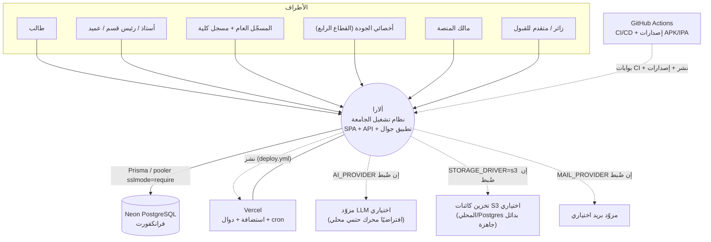

# C4 المستوى 1 — مخطط السياق

> الغرض: من يتعامل مع أُلارا وما الأنظمة الخارجية المرتبطة بها — بلا تفاصيل داخلية.

ملاحظات الصدق (مطبوعة في README أيضًا):

- المساعد الذكي «Oasis» يعمل افتراضيًا بمحرك **حتمي محلي** معلن (`gap-aware-composer`)،
  ومزوّد LLM خارجي **اختياري** فقط عبر `AI_PROVIDER` — حدود المعلنة في
  `docs/architecture.md` §8.
- فحص الانتحال محاكاة حتمية معلنة بلا خدمات خارجية.
- مزوّدو S3/البريد/LLM كلهم فشل-مغلق في `backend/src/env.ts`: نصفي التكوين يُرفض عند الإقلاع.
