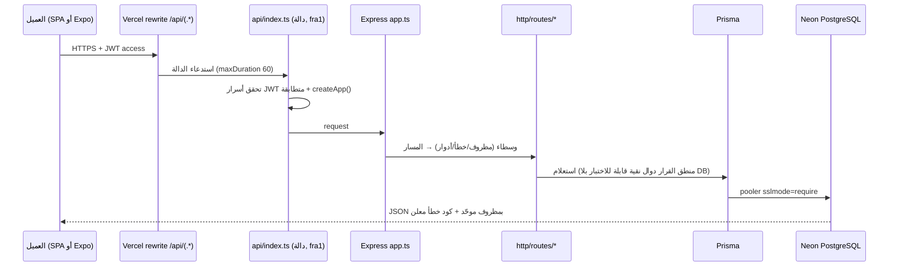

# تدفق البيانات — Data Flow

> الغرض: المسارات الخمسة الأساسية لسريان البيانات، كما هي في الشيفرة (بلا تزيين).

## 1) طلب API قياسي (الويب أو الجوال)



- المصادقة: access + refresh (سِرّان مختلفان إلزاميًا ≥32 بايت، argon2 للكلمات)؛
  البيانات الشخصية قبل اختيار سياق المؤسسة تُرفض 403 `INSTITUTION_CONTEXT_REQUIRED`
  بتصميم (عزل المؤسسات).
- الردود تخضع مظروفًا موحّدًا وأكواد خطأ معلنة — العقد كله في `docs/api/openapi.json`.

## 2) رفع PDF ورحلة البحوث

```text
المستخدم → مسار البحوث → تجريد التخزين (STORAGE_DRIVER: local|s3|postgres)
        → سجل الورقة في PostgreSQL → فحص الانتحال (محاكاة حتمية معلنة)
        → مراجعة الأستاذ بشروح داخلية على PDF → نشر في المكتبة (بحث نصي عربي)
        → القراءة في العميل عبر pdfjs كسول (بحث صفحات، تظليلات)
```

## 3) المهمة اليومية (cron)

```text
Vercel cron (0 3 * * *) → GET /api/v1/jobs/daily
  يوقّع بـCRON_SECRET == INTERNAL_SERVICE_TOKEN (مقارنة زمن-ثابت)
  → scheduler.ts: إشعارات متأخرة، تنظيف، تحديث عدّادات حية
```

## 4) بثّ المساعد الذكي (SSE)

```text
صفحة AI (route-lazy) → lib/ai-stream.ts (عميل SSE مستقل، خارج حزمة الدخول)
  → /api/v1/ai (حد يومي AI_DAILY_LIMIT_DEFAULT)
  → AI_PROVIDER: gap-aware-composer (حتمي محلي — الافتراضي)
              أو مزوّد LLM خارجي (AI_BASE_URL/AI_API_KEY — اختياري)
```

الحدود المعلنة لا تتغير حسب المزوّد — موثّقة في `docs/architecture.md` §8.

## 5) الجوال: تزامن العقد لا الحزم

```text
schema.prisma → generate-openapi.ts → docs/api/openapi.json
  → apps/mobile: npm run api:types → src/api/schema.generated.ts (متتبع)
  → CI: contract-check + tokens:check يفشلان عند أي انجراف
  → التوزيع: APK متدفق (releases/latest) وIPA SideStore — JS الجديد يتطلب ثنائيًا جديدًا
```

## قواعد ثابتة يكشفها التدفق

1. **نقطة دخول واحدة للبيانات**: كل الكتابة عبر Prisma تحت Express — لا عميل يلمس القاعدة.
2. **فشل-مغلق**: أي تكوين نصف (S3/AI/بريد) يرفض الإقلاع في `env.ts`.
3. **العقد مولّد لا مُحرَّر**: openapi.json إعادة توليد لا تحرير يدوي؛ وحوادث الإصدار
   تنكشف بـcontract-check قبل الدمج.
4. **مهام ثقيلة خارج HTTP**: البذر والنسخ الاحتياطي والتحصين سكربتات مشغّل
   (`scripts/db-*.mjs`) لا دوال serverless (سقف 60 ثانية).
