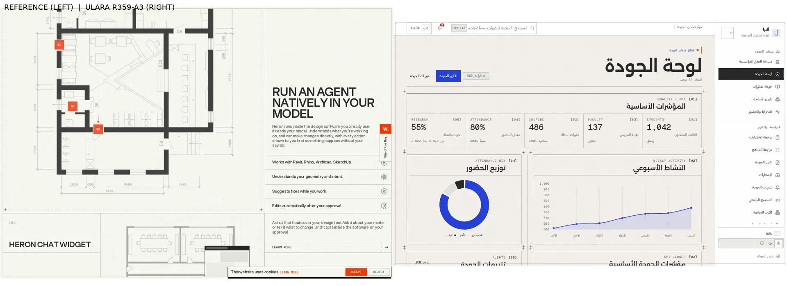

# Fidelity sheet 1 — The grammar translation — reference platform section vs the rebuilt quality dashboard

## The critique (VLM-measured, point by point)

# Fidelity Critique: ULARA R359-A3 vs. Reference

## (1) Composition / lateral rhythm
**TOP:** Strong asymmetric split — drawing dominates left ~⅔, text column right ~⅓, anchored by a hairline spine. The rhythm is intentional and readable.
**BOTTOM:** Holds its own, roughly. A two-thirds content zone plus right sidebar mirrors the split, but the sidebar is a soft-shaded rounded panel rather than a hairline-drawn column — it reads as "SaaS app," not "drafting sheet." The mirrored RTL logic is correct.
**Verdict:** Near-hold; the sidebar's shadow/radius breaks the drafting language.

## (2) Density
**TOP:** Sparse and deliberate — one big drawing, one text block, lots of air.
**BOTTOM:** Denser (it's a dashboard; that's fair), but the KPI strip and chart cards pack information with reasonable breathing room. Density is higher but not cluttered.
**Verdict:** Holds, with the caveat that the top bar (search, notification pill, "Ctrl K" chip) injects noise the reference wouldn't permit.

## (3) Typography scale & hierarchy
**TOP:** One giant grotesque headline, one small body size, mono micro-labels. Extreme, confident contrast.
**BOTTOM:** Good step-down hierarchy — huge Arabic title, mid-size section titles, small mono indices. The Latin mono micro-labels (QUALITY / KPI [01], ATTENDANCE MIX [04]) are a genuinely nice touch.
**Verdict:** Holds — arguably the strongest fidelity point.

## (4) Hairline weight & framing
**TOP:** True hairlines everywhere; frames are drawn, not filled. Registration marks and dimension ticks reinforce the drawing metaphor.
**BOTTOM:** Card borders are hairline, and the crop-mark "+" ticks on the KPI panel are an excellent borrowed detail. But the active nav item is a solid dark fill and the sidebar is shadowed — fills where the reference draws lines.
**Verdict:** Mostly holds; filled states undercut it.

## (5) Alignment to a grid
**TOP:** Everything snaps to an invisible modular grid; the drawing's dimension lines make the grid explicit.
**BOTTOM:** KPI cells align cleanly; chart cards sit on a consistent two-column rhythm. But top-bar elements (search, chips, notification) float at inconsistent offsets.
**Verdict:** Holds in the body, slips in the chrome.

## (6) Empty space discipline
**TOP:** Masterclass — whitespace is structural.
**BOTTOM:** Acceptable, but the header zone (title + action chips + meta) is tighter and slightly airless compared to the reference's generous margins. Padding inside cards is a bit cramped at the edges.
**Verdict:** Partial hold — bottom is visibly more anxious.

## (7) Color discipline
**TOP:** Paper/ink/hairline + ONE orange-red signal. Nothing else.
**BOTTOM:** Paper/ink + ONE royal blue signal, used consistently (donut, chart fill, active state, title marker). Very disciplined — this is a faithful translation of the rule, not just the palette.
**Verdict:** Holds fully.

## (8) Mono micro-labels & bracketed indices
**TOP:** [01] index, mono annotations.
**BOTTOM:** [01]–[04] bracketed mono indices on every panel — faithfully adopted, even mirrored appropriately.
**Verdict:** Holds — possibly exceeds the reference in systematic application.

## (9) Motion character
**TOP:** Not inferable; presumably minimal.
**BOTTOM:** Not inferable from a still either. Both neutral.
**Verdict:** Indeterminate — tie.

---

## Final verdict
Yes — a designer would pick the reference as better on identifiable points: **(1) composition** (the sidebar chrome breaks the drafting metaphor), **(4) hairline framing** (filled/shadowed states versus drawn lines), and **(6) empty space discipline** (the reference breathes; the bottom's header zone is cramped). On typography, color discipline, and mono indices, the bottom genuinely holds its own.

## The A3 ruling on the critique

(written by the agent after the fix pass — see LEDGER.md §fidelity)
