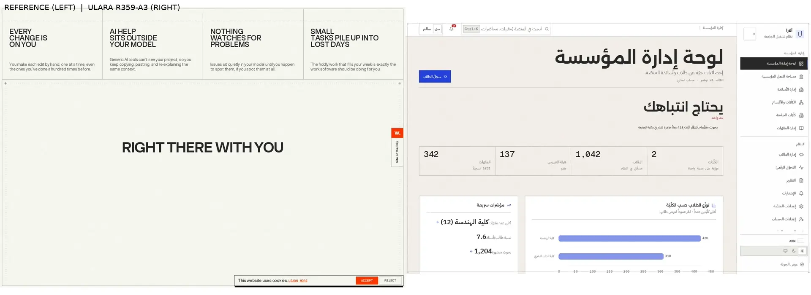

# Fidelity sheet 2 — Columns and indices — reference problems band vs the admin KPI band

## The critique (VLM-measured, point by point)

# Fidelity Critique — Reference (left) vs. ULARA R359-A3 (right)

## Composition
- **Reference**: Strict 4-column editorial band. Equal column widths, content top-aligned, generous bottom whitespace before the oversized "RIGHT THERE WITH YOU" statement. Negative space is doing deliberate work — the empty field is part of the composition.
- **ULARA**: KPI band is 4 cells, matching the reference's column logic, and that's the strongest inheritance in the build. But the surrounding dashboard (charts, sidebar, cookie-strip replica) fills space reactively; the bar-chart panel bleeds past the viewport edge with no terminal rule, which the reference never permits.

## Density
- **Reference**: Sparse and confident — one sentence per cell, ~15–20 words, nothing else.
- **ULARA**: KPI cells add caption + sub-caption + index, so each cell carries ~2–3× the reference's payload. It works because the numeral dominates, but it's denser than the model, not a flaw per se. The chart section tips into clutter by comparison.

## Type hierarchy
- **Reference**: Three clean registers — mono index, condensed bold uppercase heading (3-line stack), small body. Zero mixing.
- **ULARA**: Correctly reproduces the trio (index [01]–[05], Latin captions, huge mono numerals). Numerals are convincingly oversized. Weakest point: Arabic/Latin caption weight contrast is soft; captions and sub-captions sit close in scale, flattening hierarchy inside each cell. The big Arabic display heading is strong, but its hierarchy is a separate system from the KPI band.

## Hairlines
- **Reference**: Full-width hairline above the column band, verticals between columns, terminal rule at band bottom. Consistent weight.
- **ULARA**: Reproduces the framing well — verticals between KPI cells, horizontal cap, index-anchored cells. Matches. Deduction: inconsistent rule discipline elsewhere (chart panel edges, sidebar hairlines vary in weight), where the reference is uniform throughout.

## Grid alignment
- **Reference**: Everything snaps — indices, headings, rules share baselines.
- **ULARA**: KPI band aligns cleanly to the band above. But the quick-request card (left) and chart panel (right) sit on slightly different baselines, and the chart panel's right edge runs off-grid. Reference would never tolerate a ragged terminal edge.

## Color discipline
- **Reference**: Essentially two colors — ink on paper-white, one orange accent chip.
- **ULARA**: Mostly disciplined (off-white, ink, one blue accent for CTAs), but the bar-chart blues (two tints), red notification badge, and blue link row add a fourth/fifth hue the reference's vocabulary wouldn't allow. Charts are the color leak.

## Verdict
Would a designer pick the reference as better? Yes, on **four points**:

1. **Grid alignment** — the ragged, bleeding chart-panel edge is the most visible fidelity break; the reference's terminal discipline is intact.
2. **Hairline consistency** — uniform single weight vs. ULARA's mixed rules outside the KPI band.
3. **Color discipline** — two colors vs. chart blues + badge red; the reference's restraint is a design choice ULARA diluted.
4. **Density/negative space** — the reference's intentional emptiness vs. ULARA's reactive fill.

**Where ULARA actually matches or wins**: the KPI band itself is a faithful, competent transfer — indices, captions, oversized numerals, hairline cells all present and roughly correct. And it's arguable that *in a working dashboard* ULARA's higher information density is appropriate; a designer wouldn't want the reference's sparse editorial pacing on a stats screen. So the correct verdict isn't "make it sparser" — it's "extend the KPI band's discipline (uniform hairlines, hard terminal edges, two-color cap) to the chart and card zone."

## The A3 ruling on the critique

(written by the agent after the fix pass — see LEDGER.md §fidelity)
