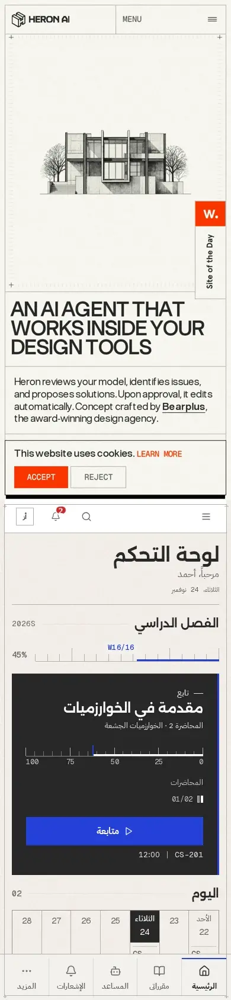

# Fidelity sheet 3 — Mobile grammar — reference mobile vs the ULARA shell at 390



## The critique (VLM-measured, point by point)

## FIDELITY CRITIQUE

---

### Composition

**Reference:** Portrait-dominant hero — a single framed technical drawing occupying ~50% of the viewport, registration marks (+) at corners, micro-labeled rail ("Site of the Day" vertical tab, orange "W." badge). Headline block sits low, pushing content below fold. Cookie banner as an inline card, not an overlay. Very editorial, poster-like.

**ULARA:** Standard app-shell rhythm — topbar (RTL: avatar left, bell/search/hamburger right), huge Arabic display title "لوضة التحكم", byline cluster, then semester header with a **W16/16 week ruler**, dark "featured lecture" card, then a hairline day-strip calendar, then a bottom tab bar. More chrome, less emptiness. The drawer rail mentioned is absent in favor of the hamburger — composition is closer to a dashboard than a poster.

**Delta:** Reference breathes; ULARA is dense. RTL mirroring of the topbar is correctly done (icon cluster flips side).

---

### Type scale on mobile

Reference: headline ~34–36px, tight tracking, tight leading — clearly the largest element on the page. Everything else is tiny (11–12px mono labels).

ULARA: Arabic title is genuinely huge (~44–46px) — arguably larger than the reference's headline, which is faithful to the "display-first" move. Body/KPI text ~12–14px. The featured-card Arabic headline is also large. Scale hierarchy holds, but the gap between "display" and "everything else" is less extreme than the reference — there's a muddier mid-tier (section headers like "الفصل الدراسي" compete with the title).

---

### Hairline framing

Reference: strong — outer frame with corner registration marks, boxed cookie card with visible border, hairline dividers between sections.

ULARA: hairlines present (semester ruler ticks, calendar day cells with 1px borders, card with thin border) but the **registration-mark gesture is dropped entirely** — no corner ticks, no outer page frame. The calendar strip does echo the reference's grid discipline nicely (numbered cells, one inverted "today" cell). Partial carry.

---

### Color discipline

Reference: near-mono — ink black, warm off-white, **one orange** (accent: ACCEPT button, LEARN MORE, "W." badge). Extremely disciplined.

ULARA: mostly disciplined too — ink, off-white, **one blue** (accent: W16/16 label, progress bar, CTA, active tab). But the dark charcoal featured card introduces a second surface weight the reference never uses, and the bell's red notification dot is a stray hue the reference would never permit.

---

### Micro-labels

Reference: mono, all-caps, tiny, technical — "MENU", "Site of the Day", ruler numbers.

ULARA: good effort — "2026S", "W16/16", "45%", "المحاضرات 01/02", "12:00 | CS-201", day numbers. The tabular/numeric labels match the reference's instrument-panel voice. Arabic micro-labels are set in the body font rather than a mono cut, which slightly softens the technical feel, but that's a fair adaptation.

---

## Verdict

A designer **would** pick the reference out as better on several points:

1. **Color discipline** — the reference's single-accent rule is absolute; ULARA leaks (red badge, dark card surface).
2. **Whitespace / composition courage** — the reference lets the drawing dominate; ULARA fills every band.
3. **Registration marks & outer framing** — the reference's signature print-production detail is entirely absent in ULARA.

Where ULARA holds its own: Arabic display type scale (arguably bolder), numeric micro-label voice, and the hairline calendar grid. As a mobile adaptation it's competent but "appified" — it inherits the vocabulary while losing the poster's restraint.

```css
/* restore reference discipline: kill stray hues, add registration marks */
.notification-dot { display: none; }
.frame {
  position: relative;
  border: 1px solid var(--ink);
  margin: 4px;
}
.frame::before,
.frame::after {
  content: "+";
  position: absolute;
  font: 11px/1 var(--mono);
  color: var(--ink);
}
.frame::before { top: 4px; inset-inline-start: 6px; }
.frame::after  { bottom: 4px; inset-inline-end: 6px; }
```

## The A3 ruling on the critique

(written by the agent after the fix pass — see LEDGER.md §fidelity)
