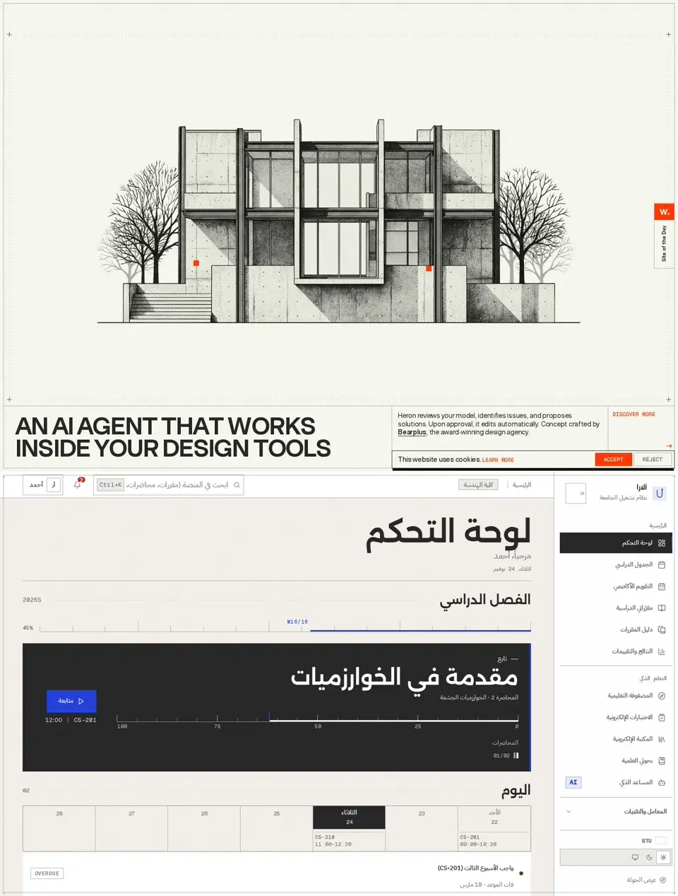

# Fidelity sheet 4 — Paper/ink/signal — reference hero vs the student dashboard

## The critique (VLM-measured, point by point)

# FIDELITY CRITIQUE — Reference vs. ULARA Dashboard

## Composition
**Reference:** Masterful asymmetric balance. The ink illustration floats in enormous whitespace (~60% breathing room), then a dense typographic band anchors the bottom: huge headline bottom-left, tiny justified paragraph + link bottom-right. The eye travels: drawing → headline → footnote. It's a poster, not a UI.

**ULARA:** Dense two-column RTL layout — hero card, ruler, timetable strip, black lecture card, week grid, sidebar. Competent, but it's *occupied* rather than *composed*. Whitespace is rationed, not deployed. The bottom-left "OVERDUE" tag nearly touches the viewport edge — the reference would never tolerate that.

**Winner: Reference.** Not close.

## Ink/Paper Discipline
**Reference:** One idea: warm paper + monochrome ink + hand-drawn hatching. Texture lives in the illustration itself (cross-hatching, stippled shadows). Every gray area is *drawn*, not filled.

**ULARA:** Paper tone and ink outlines carry through nicely (hero card, week grid, ruler). But the black lecture card is a solid fill, not a drawn surface — it imports flat UI black into a drawing language. The royal blue (#2b3fd4-ish) progress line and the blue CTA chip feel like a second, cooler system sneaking in.

**Winner: Reference.** ULARA is ~75% faithful; the black card breaks the spell.

## Type Scale
**Reference:** Brutal jump — display grotesque at ~48–56px vs. 10–11px micro-copy. Three sizes total. The contrast *is* the design.

**ULARA:** Huge Arabic title (~72px) honors the scale jump, and the mid-tier ("الفصل الدراسي") sits well. But the sidebar and grid produce 6–7 competing sizes of similar weight, muddying the hierarchy.

**Winner: Reference**, though ULARA's Arabic display sizing is genuinely strong.

## The ONE Signal
**Reference:** Orange appears exactly three times, all tiny: two annotation squares on the drawing, one "W." badge. Signal = surgical.

**ULARA:** The royal blue progress line + "10/10" chip + blue CTA button — blue is doing three jobs at three scales. Still restrained compared to typical dashboards, but it's a *system* of signals, not one signal. Also orange text sneaks in ("OVERDUE" is pale, fine — but the sidebar highlight + AI chip add a third accent family).

**Winner: Reference.** One color, one job.

## Micro-Labels
**Reference:** Registration crosses, corner ticks, "Site of the Day" rotated tab — labels double as drafting instrumentation.

**ULARA:** This is ULARA's *best* move and arguably beats the reference: ruler numerals (180→0), CS-201/12:00 course codes, 02/03 pagination, 46% progress, semester chips, tabular week numbers. The drafting-instrument metaphor is extended into function, not just decoration. RTL micro-labeling (Arabic + Latin codes) is handled cleanly.

**Winner: ULARA** on this single axis.

---

## Verdict
Yes — a designer would pick the reference as better on **composition, ink/paper discipline, and signal restraint**. ULARA earns a point only on **micro-labels**, where it operationalizes the drafting language the reference merely decorates with. ULARA's failure mode is predictable: it kept the paper-and-ink *skin* but reverted to dashboard density, losing the whitespace budget that makes the reference feel authored rather than assembled.

## The A3 ruling on the critique

(written by the agent after the fix pass — see LEDGER.md §fidelity)
